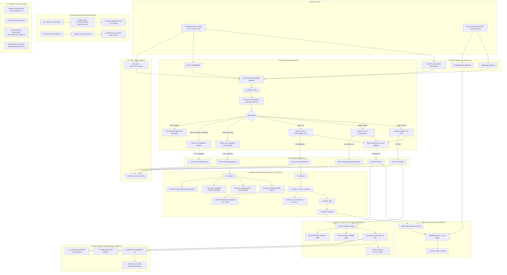

# Code Execution & Data Flow Architecture (flow.md)

This document maps the complete journey of byte streams, state transitions, and function invocations across the `ansi-parser` crate.

---

## 1. High-Level System Architecture



---

## 2. File-to-File Relationship Map

```
┌──────────────────────────────────────────────────────────────────────────────────────────────────┐
│                                           src/lib.rs                                             │
│  - Root crate export                                                                             │
│  - Public Event AST enum (Print, Control, Csi, Osc, Dcs)                                         │
│  - Core sequence structs (CsiSequence, OscSequence, DcsSequence)                                 │
└───────┬──────────────┬──────────────┬──────────────┬────────────┬─────────────┬────────────┬─────┘
        │              │              │              │            │             │            │
        ▼              ▼              ▼              ▼            ▼             ▼            ▼
┌──────────────┐┌──────────────┐┌──────────────┐┌───────────┐┌───────────┐┌───────────┐┌──────────┐
│src/parser.rs ││ src/csi.rs   ││ src/osc.rs   ││src/style.r││src/stream.││src/screen.││src/input│
│- Parser      ││- CsiAction   ││- OscAction   ││- Style    ││- AnsiReade││- Screen   ││- KeyCode │
│- State enum  ││- SgrAction   ││- Hyperlink   ││- Tracker  ││- AnsiSpan ││- Grid     ││- Mouse   │
│- feed_each   ││- Color       ││- Clipboard   ││- Span     ││- Iter     ││- Cell     ││- Decode  │
└───────┬──────┘└──────────────┘└──────────────┘└─────┬─────┘└─────┬─────┘└─────┬─────┘└──────────┘
        │                                             │            │            │
        ▼                                             ▼            ▼            ▼
┌──────────────┐                              ┌─────────────┐┌───────────┐┌───────────┐
│ src/util.rs  │                              │ HTML / CSS  ││std::io::  ││src/diff.rs│
│- strip_ansi  │                              │ Rendering   ││Read stream││- Diff/SVG │
│- to_bytes    │                              └─────────────┘└───────────┘└───────────┘
└──────────────┘
```

---

## 3. Detailed Function-by-Function Flow

### A. The Ingestion & State Transition Cycle

#### 1. Entry Point: `Parser::feed` vs `Parser::feed_each`
- **File**: [`src/parser.rs`](file:///mnt/projects/ansi-parser/src/parser.rs)
- **Signature**:
  ```rust
  pub fn feed(&mut self, input: &[u8]) -> Vec<Event>
  pub fn feed_each<F>(&mut self, input: &[u8], mut callback: F) where F: FnMut(Event)
  ```
- **Flow**:
  1. `feed(&[u8])` creates a local `let mut events = Vec::new()`.
  2. Calls `self.feed_each(input, |event| events.push(event))`.
  3. Returns `events`.
  4. This design guarantees zero duplicated parsing logic while giving high-throughput streaming applications direct zero-allocation callback performance.

#### 2. Byte Loop & State Taking
- **Function**: `feed_each`
- **Mechanism**:
  ```rust
  let state = std::mem::replace(&mut self.state, State::Ground);
  ```
  `std::mem::replace` temporarily parks `self.state` in `State::Ground` and takes full ownership of the previous `State` enum without any heap re-allocations or `.clone()` calls.

#### 3. Character Batching & `flush_text`
- **Helper**:
  ```rust
  fn flush_text<F>(text: &mut Vec<u8>, callback: &mut F) where F: FnMut(Event)
  ```
- **Trigger**: Called whenever an escape sequence (`0x1B`), C0 control byte (`0x00`..=`0x1F`), or end of input chunk is reached.
- **Action**: If `text` is non-empty, invokes `callback(Event::Print(std::mem::take(text)))`.

---

### B. CSI (Control Sequence Introducer) Flow

When `\x1b[38;2;255;128;0m` travels through the system:

```
[0x1B]           --> State::Ground transitions to State::Escape
['[']            --> State::Escape transitions to State::Csi { params: [], ... }
['3','8',';',    --> State::Csi appends bytes to parameter_bytes
 '2',';',...]
['m']            --> Final byte (0x40..=0x7E) matches!
                     Emits Event::Csi(CsiSequence { parameter_bytes, intermediates, final_byte: b'm' })
                     State returns to State::Ground.
```

#### Typed Interpretation Flow:
1. Consumer calls `csi_seq.action()` in [`src/csi.rs`](file:///mnt/projects/ansi-parser/src/csi.rs).
2. `csi_seq.parse_numeric_params()` scans `parameter_bytes`:
   - Checks if first byte is `b'?'` (flags `is_private = true` for DEC modes).
   - Splits on `;` and `:` into `Vec<Option<u16>>`.
3. If `final_byte == b'm'`:
   - Diverts to `csi_seq.parse_sgr()`.
   - Iterates through numeric parameters.
   - For `38` or `48`, calls `parse_extended_color`:
     - Checks for 5-element ITU colon format (`38:2::r:g:b`).
     - Falls back to 4-element standard format (`38;2;r;g;b` or `38;5;n`).
   - Produces `CsiAction::Sgr(vec![SgrAction::SetForegroundColor(Color::Rgb(255, 128, 0))])`.
4. If `final_byte == b'H'`:
   - Extracts row and col (defaulting omitted parameters to 1).
   - Produces `CsiAction::CursorPosition { row, col }`.

---

### C. OSC (Operating System Command) Flow

When `\x1b]0;Title\x07` or `\x1b]0;Title\x1b\` travels through the system:

```
[0x1B]           --> State::Ground transitions to State::Escape
[']']            --> State::Escape transitions to State::OscString { payload: [], saw_escape: false }
['0',';',...]    --> Appended to payload up to MAX_OSC_PAYLOAD (4096 bytes)
                     (If > 4096, transitions to State::OscIgnore)
Terminator:
- [0x07 (BEL)]   --> Emits Event::Osc(OscSequence { payload, terminator: OscTerminator::Bell })
- [0x1B, '\\']   --> First sees 0x1B (sets saw_escape = true).
                     Next sees '\\' (detects ST).
                     Emits Event::Osc(OscSequence { payload, terminator: OscTerminator::St })
```

---

### D. DCS (Device Control String) Flow

When `\x1bP1$q"p\x1b\` (DECRQSS status query) arrives:

```
[0x1B]           --> State::Ground transitions to State::Escape
['P']            --> State::Escape transitions to State::DcsEntry
['1']            --> Collected in parameter_bytes
['$']            --> Collected in intermediates (0x20..=0x2F sets saw_intermediate = true)
['q']            --> Final command byte!
                     Transitions to State::DcsString { parameter_bytes, intermediates, final_byte: b'q', payload: [] }
['"','p']        --> Appended to payload up to MAX_DCS_PAYLOAD (32768 bytes)
Terminator:
- [0x1B, '\\']   --> Matches ST.
                     Emits Event::Dcs(DcsSequence { parameter_bytes, intermediates, final_byte, payload, terminator: St })
```

---

### E. ANSI Stripping Flow (`src/util.rs`)

When `strip_ansi(input)` is called:

```
                  ┌────────────────────────┐
                  │   input: &[u8]         │
                  └───────────┬────────────┘
                              │
                              ▼
                  ┌────────────────────────┐
                  │   Parser::feed_each    │
                  └───────────┬────────────┘
                              │
          ┌───────────────────┼───────────────────┐
          │                   │                   │
          ▼                   ▼                   ▼
    Event::Print(bytes) Event::Control(b)    Event::Csi / Osc / Dcs / Escape
          │                   │                   │
          │                   ▼                   │
          │          matches \n, \r, \t ?         │
          │             /           \             │
          │          YES             NO           │
          │           │               │           │
          ▼           ▼               ▼           ▼
      ┌──────────────────┐        ┌──────────────────┐
      │  clean.extend()  │        │     Discard      │
      └─────────┬────────┘        └──────────────────┘
                │
                ▼
      ┌──────────────────┐
      │  clean: Vec<u8>  │
      └──────────────────┘
```

---

### F. Typed OSC Action Flow (`src/osc.rs`)

When `\x1b]52;c;SGVsbG8=\x07` (clipboard write) or `\x1b]8;;https://example.com\x1b\` (hyperlink) arrives:

```
[Event::Osc(osc)] --> osc.action()
                           │
             ┌─────────────┼─────────────┐
             ▼             ▼             ▼
       OSC 0 / 2         OSC 8        OSC 52
      SetWindowTitle  SetHyperlink  Clipboard
                           │             │
                   ClearHyperlink  decode_clipboard_data()
                                         │
                                   decode_base64()
                                         │
                                   "Hello" (raw bytes)
```

---

### G. Visual Style Tracking & Styled Span Generation (`src/style.rs`)

When raw ANSI stream `\x1b[1;31mBold Red \x1b[0mNormal` is processed:

```
Stream Bytes ──► Parser::feed_each
                      │
     ┌────────────────┴────────────────┐
     ▼                                 ▼
Event::Csi(SGR 1;31)              Event::Print("Bold Red ")
     │                                 │
StyleTracker::process_event            │
  style.bold = true                    │
  style.fg = Red                       │
     │                                 │
     └─────────────────────────────────► StyleTracker creates:
                                         StyledSpan {
                                           text: "Bold Red ",
                                           style: { bold: true, fg: Red }
                                         }
                                               │
                                               ▼
                                         span.to_html() ──► <span style="font-weight:bold;color:#cd0000;">Bold Red </span>
```

Adjacent spans sharing identical visual styles are automatically coalesced into unified text runs without redundant fragment allocations.

---

### H. Streaming Reader I/O Lifecycle (`src/stream.rs`)

When streaming from a Unix pipe, PTY, or subprocess `child.stdout`:

```
[std::io::Read Source] (e.g. 64KB pipe buffer)
         │
         ▼
  AnsiReader::next_event()
         │
         ├── 1. Reads chunk into internal 8KB buffer
         ├── 2. Invokes Parser::feed_each
         ├── 3. Enqueues completed Event items into VecDeque
         └── 4. Pops front event and yields to Iterator caller
                     │
                     ▼
              AnsiSpanReader
                     │
         Filters events through StyleTracker
                     │
                     ▼
           Yields StyledSpan lazily
```

---

### I. Headless Virtual Screen & Grid Engine Flow (`src/screen.rs`)

When terminal streams containing cursor jumps, line clears, or alternate screens arrive:

```
[ANSI Byte Stream] ──► Screen::feed(&[u8])
                           │
                 Parser::feed_each
                           │
            ┌──────────────┼──────────────┐
            ▼              ▼              ▼
       Event::Print   Event::Control   Event::Csi
            │              │              │
       write_char     \r (col=0)     csi.action()
            │         \n (line_feed)      │
     grid.set(r, c)        │         ┌────┴──────────────────────────┐
            │         scroll_up      ▼                               ▼
       col += 1       (if at bottom) Cursor Navigation         EraseInDisplay/Line
       wrap if >= cols               (CUU, CUD, CUP, CHA)     (clear_display / clear_line)
                                           │
                                  DECSET / DECRST 1049
                                           │
                                  Switches active_grid to alt_grid
                                  Preserves/restores saved_cursor
```

---

### J. Terminal Input Encoding & Decoding Flow (`src/input.rs`)

Bi-directional communication between keyboard/mouse events and raw ANSI escape sequences:

```
HOST / TEST SCRIPT                                   TERMINAL / PTY STREAM
KeyCode::Up + Shift       ──► encode_key()       ──► b"\x1b[1;2A"
MouseEvent (Left Press)   ──► encode_mouse(Sgr)  ──► b"\x1b[<0;15;8M"
"Pasted Text"             ──► encode_paste()     ──► b"\x1b[200~Pasted Text\x1b[201~"

InputEvent::Key(Up, Shift) ◄── decode_input_sequence() ◄── Raw stdin / PTY bytes
InputEvent::Mouse(Drag)    ◄── decode_input_sequence() ◄──
InputEvent::Paste("...")   ◄── decode_input_sequence() ◄──
```

---

### K. Screen Delta Diffing & ANSI Patch Lifecycle (`src/diff.rs`)

```
Previous Screen (from) + Target Screen (to)
                    │
        ScreenDiff::compute(from, to)
                    │
     Identifies Vec<CellPatch> + cursor delta
                    │
        generate_ansi_diff(from, to)
            │
    1. Group contiguous patches on same row
    2. Emit single CUP jump: \x1b[{r};{c}H
    3. Emit SGR only when cell style changes
    4. Write character bytes directly
    5. Emit final cursor position & visibility
            │
    Bandwidth-Minimized Byte Patch
```

---

### L. `#![no_std]` + `alloc` Core Compilation & Feature Gating (`Cargo.toml`, `src/lib.rs`)

```
               Cargo Feature Selection
                          │
         ┌────────────────┴────────────────┐
         ▼                                 ▼
   default = ["std"]             --no-default-features --features alloc
         │                                 │
   Enables `std`                     Enables `#![no_std]` + `alloc`
   Includes `src/stream.rs`          Omit `src/stream.rs` (std::io::Read)
   Full std::io streaming            Pure core + alloc structures only
         │                                 │
         ▼                                 ▼
   Desktop / CLI / Servers           Bare Metal / Embedded (thumbv7em) / WASM
```

---

### M. Public API Documentation & Verified Examples Flow (`src/*`, `README.md`)

```
   Source Code Doc-Comments (/// ```rust)
                    │
   RUSTDOCFLAGS="-D warnings" cargo doc
                    │
       ┌────────────┴────────────┐
       ▼                         ▼
Compile Check Doc-Tests    Static HTML Generation
       │                         │
All Examples Validated     Clean, Warning-Free Documentation
```

---

### N. Benchmarking & CI Matrix Execution Flow (`benches/`, `.github/workflows/ci.yml`)

```
                    GitHub Actions Trigger (push / PR)
                                   │
      ┌────────────────────────────┼────────────────────────────┐
      ▼                            ▼                            ▼
Multi-OS Matrix              no_std Validation            Quality Gates
(Linux, macOS, Windows)     (thumbv7em target)      (Clippy -D warnings & fmt)
      │                            │                            │
cargo test --all-features   cargo check --no-default   cargo doc -D warnings
      │                            │                            │
      └────────────────────────────┼────────────────────────────┘
                                   │
                                   ▼
             Local Micro-Benchmark Execution (`cargo bench`)
                                   │
                     ┌─────────────┴─────────────┐
                     ▼                           ▼
            Throughput (MB/s):            Latency (µs):
            - feed_each (~60 MB/s)        - screen_diff (~90 µs)
            - strip_ansi (~25 MB/s)       - generate_ansi_diff (~85 µs)
```

---

## 4. Error Recovery & Buffer Overflow Pathways

```
Normal Operation           State::Csi / State::OscString / State::DcsString
                                          │
            Payload > Safety Limit        │    Corrupt byte sequence
         (256 CSI / 4K OSC / 32K DCS)    │
                                          ▼
                                State::*Ignore
                                          │
               Safely consumes stream with zero heap allocation
                                          │
                  Sees Final Byte / BEL (0x07) / ST (ESC \)
                                          │
                                          ▼
                                   State::Ground
                           (Parser successfully recovered)
```
